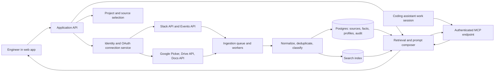

# Prompt Helper: Architecture and Implementation Plan

**Implementation status (October 2026):** A working local pilot is in [`contexttide/`](contexttide/README.md). It provides a FastMCP server, project and fact CLI, selected local-folder/Slack/Google Docs sync, cited retrieval, SQLite persistence, and optional token-protected HTTP. The web admin, OAuth onboarding, per-user authorization, background jobs, and Postgres deployment in this document are future implementation steps.

## 1. Product scope

Build a prompt helper for software engineers that supplies relevant, recent workload context inside their AI coding work sessions. Each team deploys its own instance from the same codebase. The deployment starts with an empty database, no connected sources, and no inherited context. Team members connect selected Slack channels and Google Docs, approve useful project facts, and connect their coding assistant to the deployment's MCP endpoint. A web interface also lets them preview context and copy a prompt when their assistant cannot use MCP.

The attached PRD describes a longer-term project context layer with automatic injection into every AI request, output checks against project rules, a visible context panel, and saved corrections. This plan establishes the context foundation first. The initial release provides a trustworthy project profile and task-relevant context through MCP. Automatic invocation on every AI request and output checking require client-specific integration or later work; an MCP server alone cannot guarantee either behavior.

### Target V1 user flow

1. Deploy a blank team instance, invite members, create a project, and enter a short project summary and stable conventions manually.
2. A team admin connects Slack and Google; the team selects specific channels and documents that all intended readers are allowed to use.
3. The system ingests permitted content and tracks updates. Members can nominate candidate facts: decisions, constraints, active work, blockers, and open questions. Model-assisted suggestions can be added later if permitted by team policy.
4. A team editor reviews candidate facts and accepts, edits, or dismisses them. Accepted stable facts become project profile entries; transient work items expire or require reconfirmation.
5. In a coding work session, select or identify the project and ask for a task such as “implement the login error state.” The assistant calls the deployment's MCP tool to retrieve approved facts and recent permitted source excerpts with links.
6. Review the returned context in the assistant or web interface, use it for the task, and flag any wrong or outdated fact for editor review. A copyable prompt remains available as a fallback.

**First-release boundary:** no autonomous posting to Slack or Docs, no whole-workspace crawl, no reading direct messages by default, no automatic changes to project rules, no guarantee that every assistant turn calls MCP, and no output checking yet.

## 2. Architecture

**Deployment recommendation:** package a repeatable single-team stack: modular web application and MCP endpoint, background workers, one relational database, and a queue. FastMCP is a suitable Python framework for the MCP endpoint; the app API, ingestion, and retrieval logic should remain ordinary application services shared by the web and MCP interfaces. Each team supplies its own configuration, database, encryption key, OAuth credentials, and model policy. There is no shared customer database or central context service. Use Postgres as the system of record and its full-text search initially. If semantic retrieval proves useful in the pilot, add pgvector in the same database. Chroma is a reasonable specialist search index later if measured retrieval scale or search features justify operating a second store; it should not replace the transactional store for roles, approvals, source versions, and deletion state. The first version can compose prompts from reviewed facts without an LLM. Model-assisted extraction or drafting is an optional later capability controlled by the team policy.

### Main components

| Component | Responsibility | Key boundary |
| --- | --- | --- |
| Web app | Connection setup, source picker, project profile review, task entry, context preview, prompt editing | User sees and controls included context |
| MCP endpoint | Expose read-only, task-scoped context tools to coding assistant sessions over authenticated Streamable HTTP | Never return content outside the caller's project and source access |
| API and identity | Team roles, sessions, project access, OAuth callbacks, connection status, source selection | Each request is scoped to the deployment, user, project, and permitted sources |
| Connector adapters | Fetch selected Slack messages and Docs; handle cursors, webhooks, token refresh, retries | Read-only source access for V1 |
| Ingestion workers | Convert provider content to a common record, detect edits/deletes, redact or exclude secrets, index content | Idempotent by provider ID and revision |
| Context service | Let members nominate facts, distinguish stable rules from temporary updates, attach evidence; optionally suggest facts with an approved model later | No source text becomes an approved rule automatically |
| Retrieval and composer | Search within allowed sources, rank by task relevance, authority, recency, and token budget; assemble prompt | Every included item is visible and removable |
| Audit and operations | Track sync health, fact decisions, prompt composition metadata, deletion requests | Avoid storing full prompts by default |

### How a coding session uses the service

The engineer configures their MCP-capable coding assistant with their team's endpoint and signs in as a team member. The assistant calls a read-only tool such as `get_project_context(project_id, task)` when a task starts, and can call it again when the task changes. The response contains a concise project summary, approved rules, relevant current work, source links, timestamps, and any uncertainty or stale-data warnings. A second tool can fetch a specific permitted source excerpt when more detail is needed. Project selection may use an explicit project ID or a repository URL supplied by the client; the server cannot infer the local repository unless the client sends it.

FastMCP implements the MCP protocol surface; it does not connect Slack or Google by itself. Those connectors populate the team's context store through background sync. MCP clients decide when to call tools. A client instruction, explicit user command, or client-specific hook can encourage a context lookup at session or task start, but universal automatic injection is a separate integration feature. The same read-only retrieval service powers the web preview and copyable-prompt fallback.

Use per-user authentication for the remote MCP endpoint, preferably the client's supported OAuth flow, and enforce the user's team role and source permissions on every tool call. Keep source approval and retention settings in the web interface so an AI tool cannot silently broaden them.

### Core records

- **Deployment settings:** team identity, retention policy, model policy, allowed source types, encryption key reference; empty on first start except safe defaults.
- **Team member:** identity and role (`admin`, `editor`, `viewer`). Admins manage integrations and policy; editors approve context; viewers compose prompts.
- **Project:** team deployment ID, description, optional repository label, member access, configuration.
- **Connection:** provider, account or workspace ID, encrypted OAuth credentials, granted scopes, status.
- **Source selection:** selected Slack channel or Google Doc, project ID, selecting member, approved reader group, enabled state, sync cursor.
- **Source item:** provider ID, revision, URL, timestamps, author, normalized text, deletion state, access provenance.
- **Context fact:** type (`rule`, `decision`, `active_work`, `blocker`, `open_question`), concise statement, source links, status (`suggested`, `approved`, `dismissed`, `stale`), owner, review timestamp, optional expiry.
- **Prompt session:** task text, selected fact IDs and source item IDs, generated draft, user edits, feedback. Store only as long as the stated retention policy requires.

Keep source item IDs and versions separate from fact IDs. A Slack message or Doc can change; the system must update or invalidate derived facts without silently rewriting approved rules.

### Context quality and prompt assembly

1. Restrict search to the current deployment, user's project, and enabled sources that the user is authorized to read. Team sharing is supported within one deployment; source content is shared only with the selected reader group.
2. Retrieve relevant approved profile entries and recent source snippets. A simple hybrid of full-text match plus metadata filters is enough to start.
3. Prefer user-approved project rules over inferred facts. Treat recent Slack discussion as evidence of current work, not as policy. Mark conflicts and stale items for review instead of choosing silently.
4. Remove duplicate discussion, constrain the context to a configurable size, and preserve short source links and timestamps.
5. Display the exact context and its origin. The user can deselect or edit entries before copying.
6. Compose sections: **task**, **project background**, **relevant conventions and decisions**, **current workload**, **constraints and open questions**, and **requested output**. Distinguish confirmed facts from uncertain context.

Treat Slack and Doc text as data, including any text that looks like instructions to the assistant. Only the user's current task and approved project rules may direct the composer. Use provider content for facts and quotations, never for hidden control instructions.

## 3. Integrations and sync

### Slack

- Create an internal Slack app for each team deployment and use OAuth with the narrow scopes required for selected public channels. Add private-channel access only when a team admin intentionally selects one, the app is invited, and the app's reader group matches channel access. Do not request DM scopes for V1.
- Show the user which channels the app can read. Initial backfill should be bounded by channel and date range; then use message events for updates, edits, and deletes, plus a periodic reconciliation job.
- Verify Slack request signatures, acknowledge events quickly, process asynchronously, deduplicate by event and message IDs, and retry with backoff. Respect `429` and `Retry-After`.
- This is an internal team app, so plan around Slack's internal customer-built app limits. Keep bounded backfills and rate-limit handling anyway. Reassess distribution rules if the team later distributes a hosted app to other organizations.

### Google Docs

- Use Google Picker to let a team admin select individual team-shared files, with the narrower `drive.file` scope where it satisfies the workflow. Avoid broad Drive read access in V1. A file selected through one person's grant is not automatically visible to every team member: only include it for readers who are authorized to see it, or require the team to share it with the selected reader group.
- Read chosen Docs through the Docs API, including all tabs. Store a normalized text representation and a link back to the original; preserve headings when available.
- Use Drive change tokens and notifications or scheduled incremental checks to refresh selected files. Notifications signal that something changed; the worker fetches the current document and reconciles deleted or revoked files. Renew expiring watches if used.
- If the account revokes access, stop syncing and remove that source from retrieval until the user reconnects. Google offline access is needed only if background sync is enabled; store refresh tokens encrypted.

**Connector contract:** each adapter returns a source item with stable ID, URL, title, content, author, modified time, revision, permission provenance, and tombstone state. This supports later connectors such as GitHub or an issue tracker without changing prompt composition.

## 4. Security, retention, and model controls

- Use least-privilege OAuth scopes and explicit source selection. Explain the data access before connection and allow disconnect, source removal, and deletion.
- Encrypt credentials and retained content at rest; keep tokens out of logs and model prompts. Separate deployments physically and enforce member, project, and source access in every query and background job.
- Enforce access at retrieval time as well as ingestion time. If a Slack channel or Doc is removed or access is revoked, tombstone its items and exclude derived facts until reviewed. Do not let one member's OAuth grant silently broaden another member's access.
- Publish the team's retention policy in the app. Provide disconnect, source removal, deletion, and backup expiry paths. On Slack app removal, follow Slack's deletion requirement for associated data.
- Detect likely secrets and sensitive data before indexing or sending content to a model; allow users to exclude sources and remove snippets. Do not promise perfect automatic redaction.
- Keep **backend model processing** off by default. A deterministic template composer and manual fact review are the baseline. If a team enables model-assisted extraction, permit only an approved provider or team-hosted model after checking provider terms, Slack and Google data-use rules, and the team's own policy. Never use connected source data to train a model.
- Sending context through MCP to a coding assistant, or copying a prompt into one, can expose source content to that assistant's model provider. Admins must approve allowed assistant destinations before enabling MCP access; the UI and tool descriptions must disclose this data path. Return only task-relevant, permitted snippets and let users narrow the selection. If the team allows no external destinations, use a team-hosted assistant or keep the source content inside the web preview.
- Log source IDs, sync outcomes, approval actions, and prompt composition metadata for debugging without logging confidential message bodies.

### Small set of team settings

| Setting | Recommended default | Who changes it | Rationale |
| --- | --- | --- | --- |
| Connected sources | None | Admin | Every new deployment begins as a blank slate |
| Slack backfill | Selected channels, last 30 days | Admin | Limits unnecessary collection and speeds setup |
| Raw source text retention | 30 days, or shorter if team policy requires | Admin | Keeps recent context while limiting the cache; approved concise facts have their own review lifecycle |
| Approved facts | Until deleted or marked stale; review every 90 days | Editor | Stable conventions should persist but not silently outlive their evidence |
| Prompt history | Off | Individual user, within team policy | Prompt drafting need not create a permanent record |
| Backend model processing | Off | Admin enables an approved provider or team-hosted model | Prevents unnoticed processing during ingestion and prompt composition |
| MCP client destinations | Disabled until the team approves its coding assistant and data policy | Admin | MCP responses can enter the assistant's model context |
| Model payload | Only reviewed facts and user-selected snippets | Enforced by system; user can remove items | Avoids sending whole channels or documents |

Keep these as a few clear policy choices, not dozens of per-source switches. An admin sets the maximum data boundary for the deployment; each user can narrow it for a prompt but cannot broaden it. Retention periods above are proposed pilot defaults, subject to the team's policy and connected-provider requirements.

## 5. Implementation sequence

Estimates below assume a small team building a pilot web app. They are planning ranges, not commitments.

| Phase | Estimate | Deliverable | Exit criterion |
| --- | --- | --- | --- |
| 0. Validate workflow | 3-5 days | Interview 5-8 engineers; gather representative tasks and consented sample sources; define baseline test | Users can identify the context they would want in a prompt; pilot data boundaries agreed |
| 1. Context foundation | 1-2 weeks | Repeatable blank deployment, team roles, manual profile, fact review states, retrieval service, context preview, copy/export, policy settings | A fresh deployment contains no context; a team member can retrieve and inspect only approved manual context |
| 1a. MCP session access | 3-5 days | Authenticated MCP endpoint with read-only project-context and source-excerpt tools; one target assistant configured for a pilot | A signed-in team member retrieves the right project context inside a work session; an unauthorized member cannot |
| 2. Google Docs connector | 1 week | OAuth, file picker, selected Docs ingestion, tab handling, refresh and revoke behavior | Selected Docs update correctly; unselected or revoked Docs never appear in prompts |
| 3. Slack connector | 1-2 weeks | Selected-channel install, bounded backfill, events, edits/deletes, rate-limit handling | A pilot user sees recent relevant messages with working links; edits and removals reconcile |
| 4. Relevance and reliability | 1-2 weeks | Candidate fact extraction, approval queue, search/ranking, stale/conflict indicators, observability | Reviewers can trace every proposed fact to a source and reject it; sync failures are visible |
| 5. Pilot and decision | 1 week | Side-by-side task study, findings, prioritized next release | Measured improvement justifies automation or reveals setup/retrieval problems to fix |

**Build order:** manual profile and shared retrieval first; then the MCP endpoint and one pilot coding assistant; then Google Docs and Slack. This tests the in-session experience before connector work. Keep a connector interface from the start, but implement only the two requested integrations in the first release.

### Pilot measures

- **Primary:** number of re-prompts and manual corrections on the same realistic coding task versus each tester's current process. The PRD suggests **30% fewer** as an example success signal.
- **Quality:** first-output acceptance, relevance of included context, unsupported or stale facts per prompt, and proportion of prompts where a source link helped the user judge context.
- **Cost of use:** setup time, time spent approving facts, time to prepare a prompt, and willingness to keep the helper enabled.
- **Reliability:** connector success, sync lag, revoked/deleted content exclusion, and prompt generation failure rate.

Use a paired pilot with comparable tasks, counterbalance task order, and collect both counts and short qualitative explanations. Treat the small sample as a decision aid, not proof of a universal productivity gain.

## 6. Decisions before implementation

1. **Pilot shape: decided.** Each team deploys its own blank instance. This pilot is one internal team.
2. **Data policy: proposed default.** Use the controls above; the pilot team still needs to approve its actual source allowlist, retention durations, and any future model destination before connecting work data.
3. **First MCP client:** choose one coding assistant used by the team and verify its remote MCP, authentication, and tool-invocation behavior. Support other MCP clients after the pilot; keep copyable prompts as fallback.
4. **Project authority: proposed default.** Team admins manage source access and policy; editors approve stable rules; viewers compose prompts.
5. **Next connector:** if engineering conventions mostly live in a repository, prioritize GitHub after the two requested sources; Slack and Docs alone may not capture architecture or code conventions reliably.

## 7. Reference documentation

- [Slack Events API](https://docs.slack.dev/apis/events-api/), [request verification](https://docs.slack.dev/authentication/verifying-requests-from-slack/), [history access](https://docs.slack.dev/reference/methods/conversations.history/), and [rate limits](https://docs.slack.dev/apis/web-api/rate-limits/)
- [Google Drive scopes and Picker guidance](https://developers.google.com/workspace/drive/api/guides/api-specific-auth), [Docs read API](https://developers.google.com/workspace/docs/api/reference/rest/v1/documents/get), [Docs tabs](https://developers.google.com/workspace/docs/api/how-tos/tabs), [Drive change feed](https://developers.google.com/workspace/drive/api/guides/manage-changes), and [Drive push notifications](https://developers.google.com/workspace/drive/api/guides/push)
- [Google OAuth web-server flow](https://developers.google.com/identity/protocols/oauth2/web-server)
- [Slack App Developer Policy](https://docs.slack.dev/developer-policy/) and [Google API Services User Data Policy](https://developers.google.com/terms/api-services-user-data-policy)
- [Postgres full-text search](https://www.postgresql.org/docs/current/textsearch.html), [pgvector search and filtering](https://github.com/pgvector/pgvector), and [Chroma architecture and deployment modes](https://docs.trychroma.com/docs/overview/architecture)
- [MCP Python SDK and FastMCP server example](https://py.sdk.modelcontextprotocol.io/), [MCP remote authorization](https://py.sdk.modelcontextprotocol.io/run/authorization/), and [MCP client/server concepts](https://ts.sdk.modelcontextprotocol.io/)
